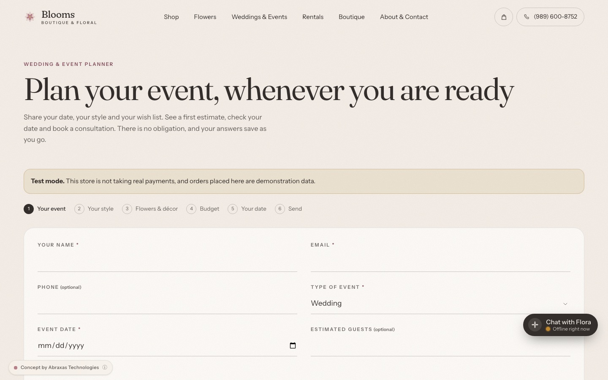
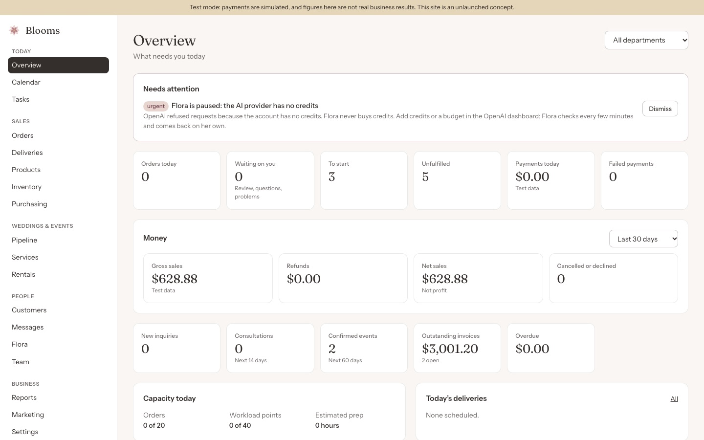
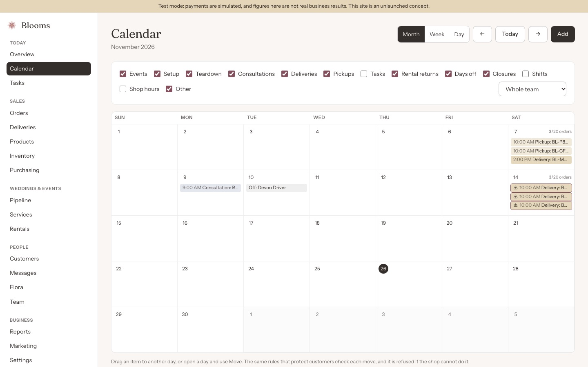
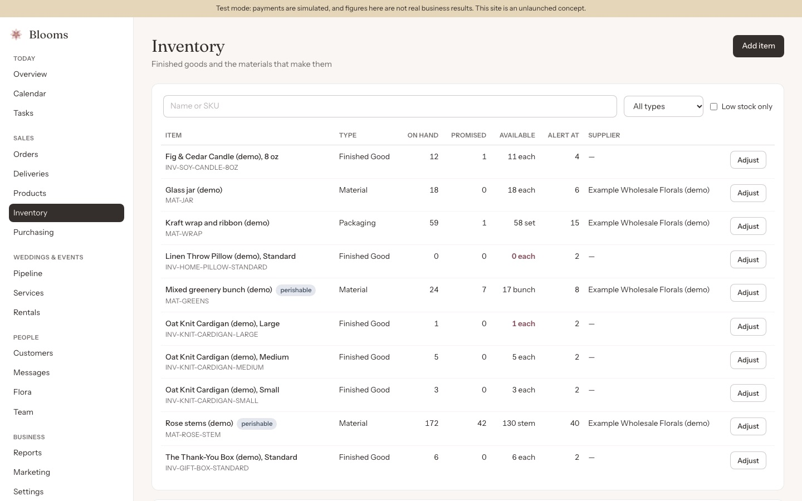
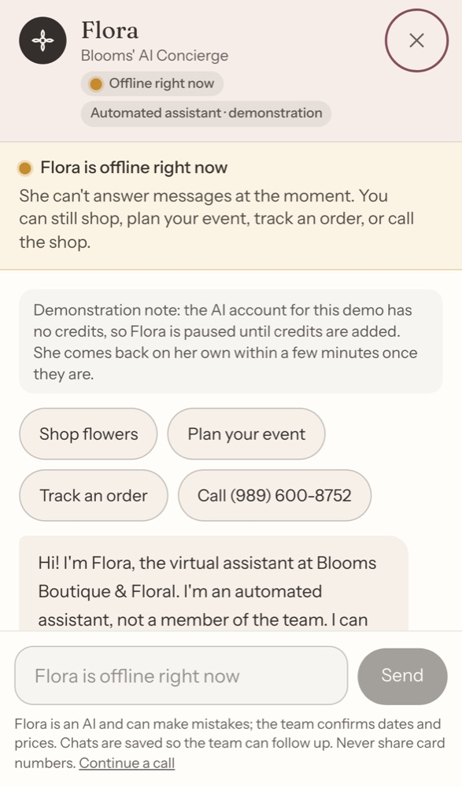

# Blooms Boutique & Floral: commerce, wedding planning and operations platform

Designed and built by **Ryan Keeling**, Abraxas Technologies.

A full-stack platform for a florist and event-decor business in Saginaw, Michigan: an online shop
with real delivery and capacity rules, a wedding and event planner, a team dashboard that runs the
business day to day, and **Flora**, an AI concierge for website chat and phone calls.


> **An independent concept, not the official Blooms website.** I built this on my own initiative.
> Blooms Boutique & Floral has not commissioned, endorsed or launched it, and it is not affiliated
> with the business. Every page says so, preview builds ask search engines not to list them,
> payments run in test mode, all products, customers and orders are fictional, and the photography
> is stock from Unsplash.

## At a glance

| | |
| --- | --- |
| **What** | Storefront and checkout, a seven-step wedding planner, a 31-screen staff dashboard, and an AI concierge on chat and voice |
| **Stack** | React 19, TypeScript, Tailwind CSS 4, Node with Hono, PostgreSQL 17 with Kysely, Stripe, OpenAI, Twilio, Docker |
| **Size** | About 40,000 lines of TypeScript, 6 SQL migrations, over 20 scheduled background jobs |
| **Tests** | 187 server tests against a real PostgreSQL database, 73 browser tests (desktop Chrome, Android-size Chrome, iPhone-size WebKit) with automated axe accessibility checks, and an end-to-end suite that runs against the published staging site |
| **Status** | Working staging demonstration in Docker, published through a Cloudflare tunnel for presentations. Not in production |

## Engineering highlights

- **Correctness enforced by the database, not just the code.** Overselling is blocked with atomic
  conditional updates and `CHECK` constraints. Double-booking a consultation or crew is blocked with
  PostgreSQL `EXCLUDE USING gist` on time ranges. Rentals are guarded by a row-locking trigger that
  includes cleaning buffers, and daily capacity is claimed under per-date advisory locks.
- **One capacity engine for everyone.** Checkout, staff drag-and-drop in the calendar, and Flora
  all ask the same engine. It weighs opening hours, preparation time, workload points, driver
  schedules, delivery windows, closures and lead times, refuses impossible requests before payment,
  and offers the earliest real alternative.
- **Reliable side effects.** Every event is stored before anything is sent. A database-backed queue
  retries with backoff and recovers after restarts, and webhooks are stored once per event and
  processed with monotonic state transitions. A six-hourly job checks that stock, payments, refunds,
  invoices and bookings all agree.
- **Payments done safely.** Customers pay on Stripe's hosted page, so card data never reaches the
  server. An order is marked paid only by a signed webhook. Pending, failed, expired, duplicate and
  late payments are all handled.
- **An AI concierge with guardrails.** Flora uses the OpenAI Responses API with tool calls into the
  same business logic, so dates and prices come from the real system, not the model. Phone calls
  bridge Twilio Media Streams (G.711 μ-law) to the OpenAI Realtime API. She has a demonstration
  sandbox, a monthly spending cap, full transcripts, and staff handoff with tickets that escalate.
  When the AI account fails, she raises an alert, tells visitors plainly that she's offline,
  and comes back on her own once the account works.
- **Security.** Permissions are checked on the server for every staff endpoint, with roles the
  owner can edit. Forms are protected by an origin check against cross-site requests, and sign-in by
  rate limits with account lockout. Uploads are type-checked, re-encoded and stored privately. The
  server refuses to start with unsafe settings, such as simulated payments in production.
- **Accessible and mobile-first.** Semantic landmarks, keyboard-operable menus and forms, axe checks
  in the browser tests, and `prefers-reduced-motion` support. On phones, the chat opens as a
  full-screen sheet that respects the iPhone's safe areas and stays above the on-screen keyboard.
- **Operations.** A production Docker image and Compose file with HTTPS, nightly backups and a restore
  check, plus a staging script that publishes the demo, verifies it from outside, and resets it.

## Screenshots

| Shop | Wedding and event planner |
| --- | --- |
|  |  |

| Team dashboard | Calendar |
| --- | --- |
|  |  |

| Inventory | Flora on a phone, while the AI account is paused |
| --- | --- |
|  |  |

## What it does

**For customers.** The original motion-rich site, now backed by a real system: an online shop for
flowers and boutique pieces, with options, pickup, delivery and shipping, and only offering times the
shop can actually meet; secure payment on Stripe's hosted page; order tracking for every item; a
seven-step wedding and event planner that works at any hour, with an honest estimate, a live date check
and consultation booking; quotes, deposits and balances; and a passwordless customer account.

**For the team.** A dashboard at `/admin` with today's work, orders, deliveries, a shared calendar,
the wedding pipeline, inventory with recipes and purchasing, rentals, customers, reports, message
templates, and every business rule. Roles limit what each person sees.

**Flora, the AI concierge.** An automated assistant on the website chat and, optionally, a phone
line. She plans weddings with customers, checks dates and prices against the real system, saves a
plan the customer reviews and sends on the website, and passes anything she cannot do to a person.
She has a demonstration sandbox, a monthly spending limit, and a full transcript in the dashboard. See
[docs/flora.md](docs/flora.md).

**Behind the scenes.** A capacity engine that weighs staff hours, workload, crews, rentals, delivery
windows and closures. The database enforces no overselling and no double booking. Background jobs
send messages, remind, reconcile payments and recover after restarts.

See [docs/implementation-report.md](docs/implementation-report.md) for exactly what is done, tested,
and still needed.

## Stack

React 19, TypeScript, Vite 7, Tailwind CSS 4, Motion 12 and React Router 7 for the site and dashboard.
Node with Hono, PostgreSQL 17 with Kysely, and Zod on the server. Stripe, Resend or SMTP, Twilio
(optional), the OpenAI API for Flora (optional), and any S3-compatible storage as integrations. Vitest
and Playwright for tests. Fonts are self-hosted (Fraunces and Instrument Sans, both SIL OFL).

## Getting started

Needs Node 22 or newer, and Docker for the local database.

```sh
npm install
cp .env.example .env
npm run db:up && npm run db:migrate
npm run db:seed:demo      # fictional products, staff and rules; prints the staff password once
npm run dev               # site at http://localhost:5173, team dashboard at /admin
```

Payments are simulated locally (`PAYMENTS_MODE=mock`), and email is recorded rather than sent.

## Scripts

| Command | What it does |
| --- | --- |
| `npm run dev` | Site, API and worker together, with reload |
| `npm run build` | Type-check, build the site, write the per-route HTML shells, and bundle the server |
| `npm start` / `npm run start:worker` | Run the built web server or worker |
| `npm run check` | Typecheck, lint, all server tests, and the production build |
| `npm test` | Server tests against a real PostgreSQL database |
| `npm run test:e2e` | Browser tests against the production build |
| `npm run db:migrate`, `db:seed:demo`, `db:reset`, `db:check`, `db:types` | Database tasks. `db:check` runs the record checks |
| `npm run admin:create -- <email> "<name>"` | Create an owner account |
| `npm run verify:stripe` | Check a Stripe test-mode connection. Refuses live keys |
| `npm run build:concept` and `npm run smoke` | The original static concept, with no backend, and its smoke test |
| `scripts/staging.sh up`, `publish`, `verify`, `reset`, `backup`, `restore-check` | The staging demonstration: run it, publish it, check it from outside, and reset it. See [the demonstration guide](docs/client-handoff/demonstration-guide.md) |
| `npm run images` / `npm run og` | Re-download the stock photography, and re-render the Open Graph cards |

## Documentation

| | |
| --- | --- |
| [Owner handoff](docs/client-handoff/README.md) | Plain-language guides for the owner, should the business adopt it, and the demonstration script |
| [Implementation report](docs/implementation-report.md) | What is finished, tested, mocked, and still needed |
| [Owner checklist](docs/owner-checklist.md) | Decisions and accounts only the business can provide |
| [Administrator guide](docs/admin-guide.md) and [staff guide](docs/staff-guide.md) | Using the dashboard |
| [Business settings](docs/business-settings.md) | Every rule and its default |
| [Operations](docs/operations.md) | Deploying, monitoring, backups, restores and rollback |
| [Flora, the AI concierge](docs/flora.md) | How the chat and phone assistant works, its safety rules, setup and costs |
| [Integrations](docs/integrations.md) | Stripe, email, Twilio, Facebook, Google Calendar and storage |
| [Services and costs](docs/costs-and-services.md) | Every outside service and what it costs |
| [Testing](docs/testing.md) | Test layers, and what is mocked versus verified |
| [Database](docs/database.md), [architecture audit](docs/architecture-audit.md), [handoff](docs/handoff.md), [troubleshooting](docs/troubleshooting.md), [implementation checklist](docs/implementation-checklist.md) | For developers and whoever maintains it |

## Facts: confirmed versus to confirm with the owner

The business details come from its public listings: the business name, co-owner Samantha Todd, the
address, phone, public email (`bloomsbotiquefloral@gmail.com`, spelled as listed), and the Facebook,
WeddingWire and The Knot profile links. Shop hours come from the township listing, and are shown as
unverified until the owner saves real hours in the dashboard. Open questions are in
[docs/owner-checklist.md](docs/owner-checklist.md).

## Replacing the imagery

Stock images are listed in `scripts/image-manifest.json` and fetched with `npm run images`, which
writes `public/img/<key>-<width>.webp` and blur placeholders in `src/data/images.json`. For the
owner's own photos, point `processOne` in `scripts/fetch-images.mjs` at local files and keep the same
keys. Then remove the "Illustrative photo" tags and the imagery note in `src/data/business.ts`.
Product photos are uploaded in the dashboard.

## Accessibility and motion

Semantic landmarks, one `h1` per page, a skip link, visible focus, keyboard-operable menus and forms,
and errors linked to their fields. Small text meets WCAG AA contrast, and the forms, shop, planner and
dashboard are checked automatically with axe in the browser tests. `prefers-reduced-motion` turns
off the intro, smooth scrolling, petals and shader animation.

## Credits

Design and development: Ryan Keeling, Abraxas Technologies. Illustrative photography:
[Unsplash](https://unsplash.com) contributors, under the Unsplash License.

© 2026 Ryan Keeling. All rights reserved. The code is shared for review and is not licensed for reuse.
